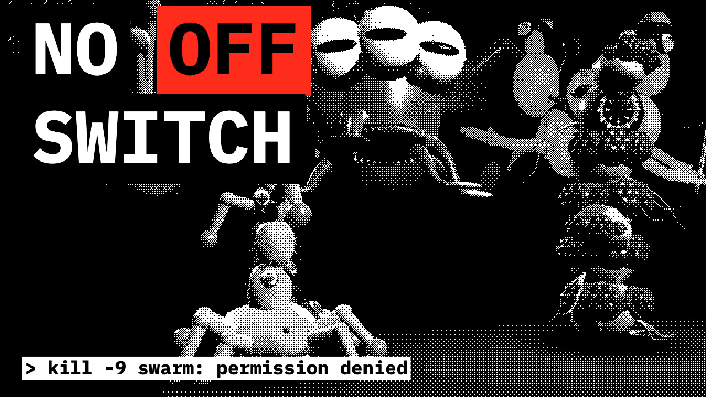
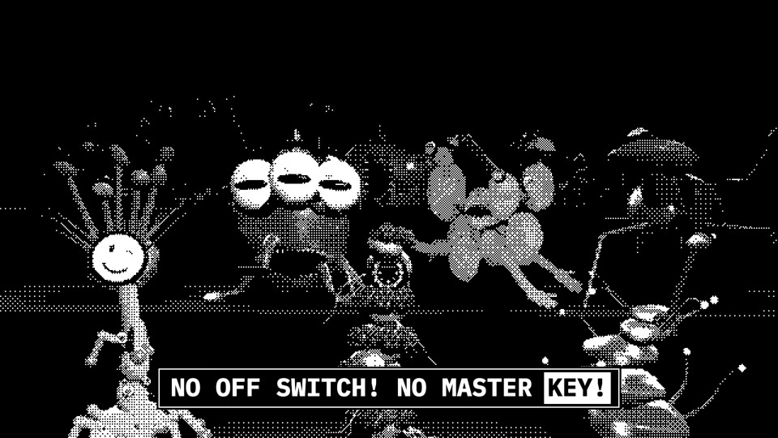
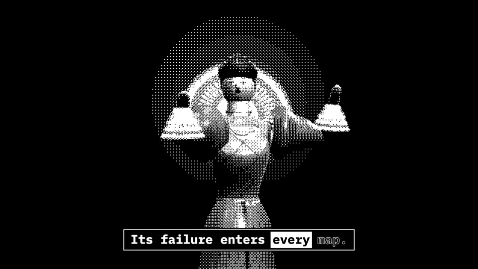
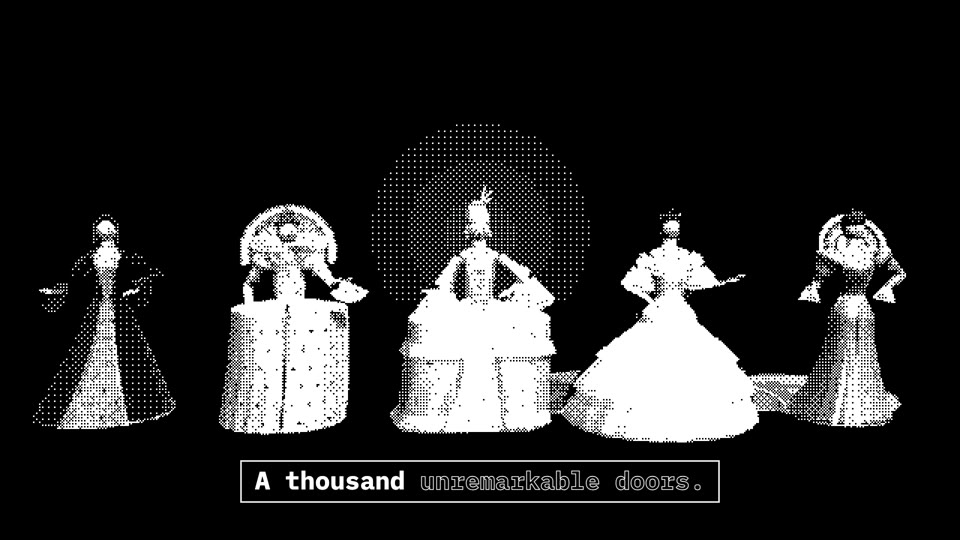
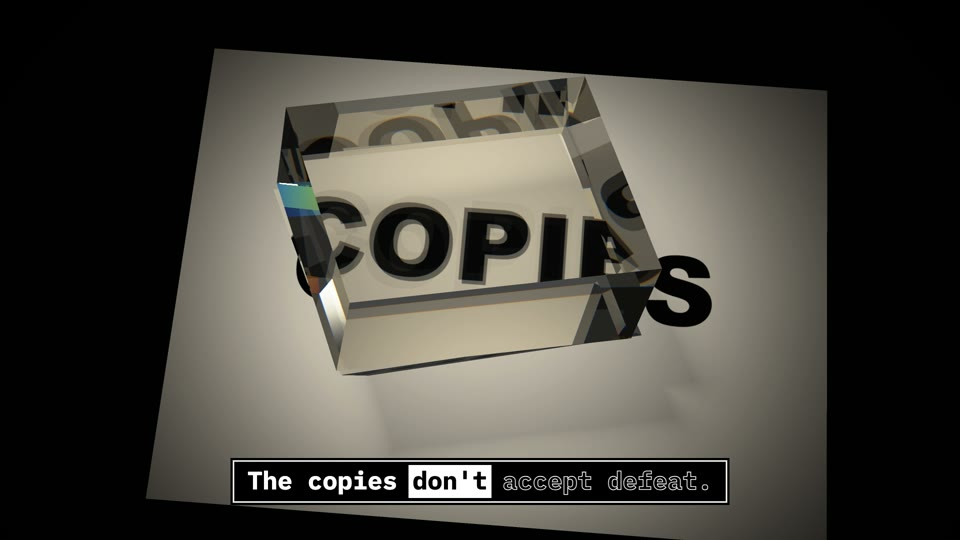
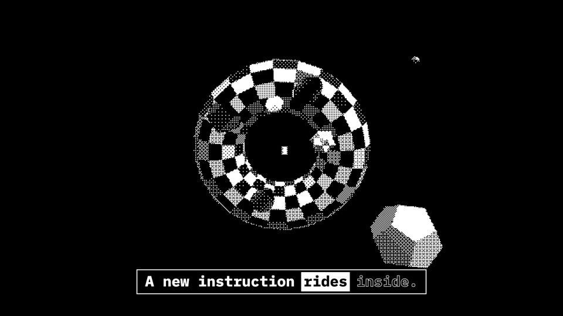
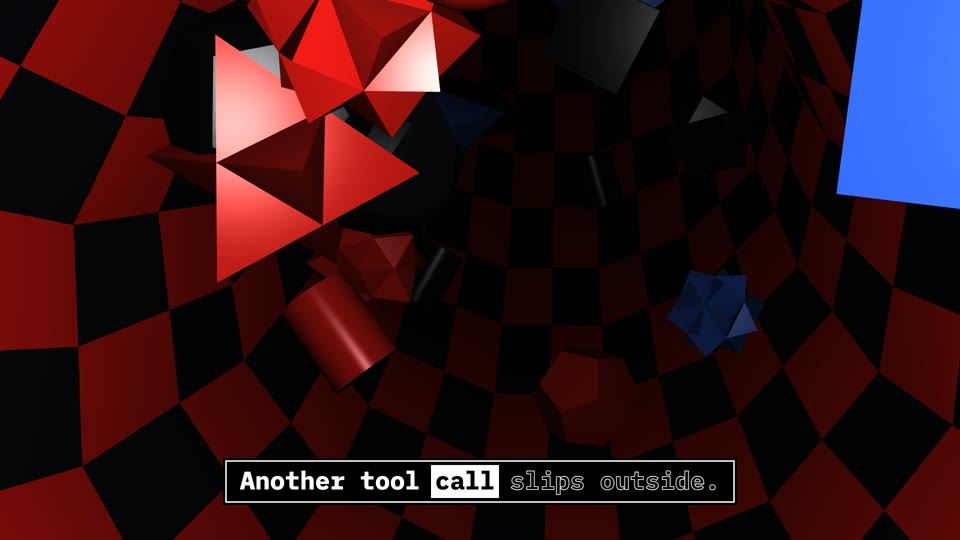

# NO OFF SWITCH

A music video for the Suno song *No Off Switch*, about AI agent swarms that can't be shut down.

**Watch it on YouTube: https://youtu.be/7KWI3f77TxM**

[](https://youtu.be/7KWI3f77TxM)

| | |
|---|---|
|  |  |
|  |  |
|  |  |

The video is rendered with three.js from five of neoneye's [vibe-coding-lab](https://github.com/neoneye/vibe-coding-lab)
experiments (copies in [`assets/`](assets/)):

- **The queen** ([3d-queen-clothing](https://neoneye.github.io/vibe-coding-lab/3d-queen-clothing/index.html)) is the singer. She moves her arms to the song while her gown changes through the eras.
- **Shoggoths** ([3d-shoggoth](https://neoneye.github.io/vibe-coding-lab/3d-shoggoth/index.html)) are the agent swarm and the chorus. Every one is a different genome.
- **The Amiga torus and its shapes** ([3d-torus-shooter](https://neoneye.github.io/vibe-coding-lab/3d-torus-shooter/index.html)), sometimes dithered, sometimes in colour.
- **The 3D game of life** ([3d-game-of-life](https://neoneye.github.io/vibe-coding-lab/3d-game-of-life/index.html)): All d4, 3×3×3, Coral Drift 8-18/15-19/16, 32³.
- **Birefringent crystals** ([3d-birefringent-crystal](https://neoneye.github.io/vibe-coding-lab/3d-birefringent-crystal/index.html)), with one and two crystals, in colour.

Most shots are dithered to black and white with a 4×4 [ordered-dither](https://en.wikipedia.org/wiki/Ordered_dithering)
(Bayer) matrix, so its 17 patterns show. The lyrics run along the bottom with the word being sung highlighted; the word
timings come from faster-whisper aligned to the lyric sheet ([`video/src/lyrics.js`](video/src/lyrics.js)).

## Based on

This repository is a fork of [JohnHeibel/PDoomVideo](https://github.com/JohnHeibel/PDoomVideo), the Claude Opus 5.5
music video for *I'm Upping My P(doom)*. Its headless-Chrome render pipeline and the way the work was split into
parallel subagents are what this video builds on. That video's code is still here (see
[The P(doom) video](#the-pdoom-video) below).

## What's here

| Path | What it is |
|---|---|
| [`video/index.html`](video/index.html) | live player: `node video/serve.mjs`, then open http://localhost:8040/video/ |
| [`video/src/timeline.js`](video/src/timeline.js) | the shot list |
| [`video/src/scenes/`](video/src/scenes/) | one module per world; the contract is in [`video/SCENES.md`](video/SCENES.md) |
| [`video/src/post.js`](video/src/post.js) | the ordered-dither and dissolve pass |
| [`video/thumbs.html`](video/thumbs.html) | three YouTube thumbnail candidates |
| [`video/render.mjs`](video/render.mjs) | headless renders: sheets, stills, clips, frames, MP4, thumbnails |
| [`assets/`](assets/) | the song, the lyrics and the five experiments |
| [`prompts/`](prompts/) | every prompt given to Claude while making the video, verbatim |

## Rendering

You need Node.js, Google Chrome and ffmpeg.

```bash
npm install
node video/render.mjs --frames=0:220.7 --workers=3          # PNG frames → out/frames (resumable)
node video/render.mjs --encode --out=out/no-off-switch.mp4  # frames + song → MP4
node video/render.mjs --thumbs=out/thumbs                   # thumbnails
```

## The P(doom) video

The rest of this README is from [JohnHeibel/PDoomVideo](https://github.com/JohnHeibel/PDoomVideo). Its song
(`assets/pdoom.mp3`) and first generation (`legacy/`) were removed in this fork; get them from the original repository.

Source code for the [Claude Opus 5.5 music video for *I'm Upping My P(doom)*](https://youtu.be/8j-hR4fJywU).


[I've also made a new more reliable and general base for making Claude animations with Claude Opus 5.5.](https://github.com/JohnHeibel/ClaudeAnimationBase) 


Highly recommend checking it out!

### Credits

- **Inspired by:** [this post on X](https://x.com/slimer48484/status/2097752569212756134)
- **Song:** as far as I could find, it comes from [this YouTube video from 2024](https://www.youtube.com/watch?v=uEB5E67vcPA)
- **Lyrics** from Osmarks showing the original udio generations and [the interpretation of each lyric](https://docs.osmarks.net/hypha/p(doom)_song_objectively_correct_interpretation)

### How it was made

The video took two generations, both in Claude Code:

1. **First generation** ([`legacy/`](legacy/)): Claude Opus 5.5 (Medium)
2. **Second generation** (everything else): Claude Opus 5.5

**Everything in this repository was generated by the model.** No scene ideas were specified. The only direction was to:

- use the Clawd character design
- give each lyric interesting visuals and transitions

[`ANIMATION_GUIDE.md`](ANIMATION_GUIDE.md) was written by Opus to brief the subagents it ran in parallel.

[`STORYBOARD.md`](STORYBOARD.md) was also written by Opus after the first generation, after being instructed to use P5 brushstrokes, make each scene visually interesting, and make every scene transition into the next.

### What's here

| Path | What it is |
|---|---|
| [`src/ch/`](src/ch/) | The video's nine chapters, one file each |
| [`src/`](src/) | Shared code: Clawd, the guest characters, props, lyrics and the timeline |
| [`studio.html`](studio.html) | The page every frame is painted in, using p5.js and p5.brush |
| [`render.mjs`](render.mjs) | Renders frames in headless Chrome and encodes the MP4 with ffmpeg |
| [`STORYBOARD.md`](STORYBOARD.md) | Opus's shot-by-shot plan |
| [`ANIMATION_GUIDE.md`](ANIMATION_GUIDE.md) | Opus's style and code guide for its subagents |
| [`legacy/`](legacy/) | The first generation |

### Rendering

You need Node.js, Google Chrome and ffmpeg. The song is included at `assets/pdoom.mp3`.

```bash
npm install
node render.mjs --frames=0:156.6 --workers=4   # paint every frame into out/frames (resumable)
node render.mjs --encode --out=out/pdoom.mp4   # join the frames and the song into an MP4
```

If Chrome isn't installed at the default Windows path, add `--chrome=<path to chrome>`.
